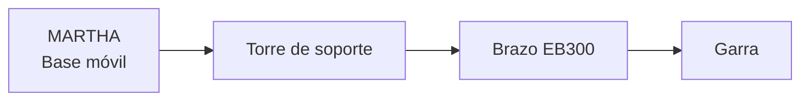

# MARTHA — Simulación e integración del brazo robótico


**MARTHA** es una plataforma robótica móvil utilizada en el proyecto **RoboCup 2027**. Este repositorio reúne el entorno de simulación y el trabajo de integración del **brazo EB300 y su garra**, tomando como referencia la implementación de **MILO**.

> **Estado actual:** integración en desarrollo. La carga, el movimiento y el control del brazo y la garra todavía requieren validación reproducible en Gazebo y ROS 2. El alcance documentado es de **software y simulación**, no de hardware físico.

## Arquitectura prevista



| Componente | Estado de documentación |
|---|---|
| Plataforma MARTHA con torre | Modelo y configuración de lanzamiento referenciados; ejecución actual por verificar. |
| Brazo EB300 | Integración planteada mediante URDF/Xacro; control articular por validar. |
| Garra | Integración y accionamiento en simulación pendientes de comprobar. |
| `ros2_control` | Disponibilidad y respuesta de controladores por verificar. |

## Requisitos

- **Ubuntu 22.04 LTS** y **ROS 2 Humble**.
- `git`, `colcon` y `rosdep`.
- Gazebo y las dependencias ROS 2 requeridas por los paquetes.

La instalación base de ROS 2 se describe en la [documentación oficial de Humble](https://docs.ros.org/en/humble/Installation/Ubuntu-Install-Debs.html).

## Instalación

**1. Clonar el repositorio** dentro de `src` (una sola vez):

```bash
mkdir -p ~/ros2_ws/src
cd ~/ros2_ws/src
git clone https://github.com/Embedar/martha_nav_robotic_arm.git
```

**2. Instalar dependencias y compilar:**

```bash
source /opt/ros/humble/setup.bash
cd ~/ros2_ws
rosdep update
rosdep install --from-paths src --ignore-src -r -y --rosdistro humble
colcon build --symlink-install
source install/setup.bash
```

> `rosdep` debe estar inicializado en el equipo. Las dependencias específicas no declaradas por los paquetes pueden requerir instalación adicional.

## Ejecutar la simulación

En una terminal con el entorno cargado:

```bash
source /opt/ros/humble/setup.bash
source ~/ros2_ws/install/setup.bash

ros2 launch martha_nav sim.launch.py \
  robot:=martha_tower \
  drive:=mecanum \
  with_arm:=true
```

| Argumento | Función |
|---|---|
| `robot:=martha_tower` | Selecciona la variante MARTHA con torre. |
| `drive:=mecanum` | Selecciona la tracción mecanum. |
| `with_arm:=true` | Solicita incluir el modelo del brazo. |

Para consultar los argumentos disponibles en la versión instalada:

```bash
ros2 launch martha_nav sim.launch.py --show-args
```

## Verificación básica

En **otra terminal**:

```bash
source /opt/ros/humble/setup.bash
source ~/ros2_ws/install/setup.bash

ros2 pkg prefix martha_nav
ros2 node list
ros2 topic list
ros2 action list
```

Si el gestor de controladores está activo, inspeccionar los controladores con:

```bash
ros2 control list_controllers
```

**Importante:** que Gazebo abra o que el robot aparezca no confirma por sí solo que las articulaciones ni la garra se puedan controlar.

## Problemas frecuentes

<details>
<summary><strong>Mostrar soluciones de compilación y entorno</strong></summary>

**`Duplicate package names not supported`**  
Hay más de una copia de un paquete ROS 2. Localiza los `package.xml` y conserva una sola copia activa de cada paquete:

```bash
find ~/ros2_ws -name package.xml \
  -not -path '*/build/*' -not -path '*/install/*'
```

**`Package 'martha_nav' not found`**  
Comprueba que compilaste y cargaste `~/ros2_ws/install/setup.bash` antes del lanzamiento.

**`can't copy .../build/martha_nav/launch/burger.launch.py`**  
Si el archivo fuente existe y el problema se debe a artefactos previos, limpia únicamente la compilación del paquete afectado y recompila:

```bash
cd ~/ros2_ws
rm -rf build/martha_nav install/martha_nav
colcon build --symlink-install --packages-select martha_nav
source install/setup.bash
```

Antes de borrar o mover directorios, comprueba que no contienen trabajo sin respaldar.

</details>


## Referencias

- [Arquitectura ROS 2 del equipo](https://alejapinzonf.github.io/Robot_arquitecture_ROS2/).
- [Documentación de ROS 2 Humble](https://docs.ros.org/en/humble/).

---

**Proyecto:** RoboCup 2027 · **Entorno de referencia:** Ubuntu 22.04 / ROS 2 Humble · **Actualización documental:** 2026-10-30.
